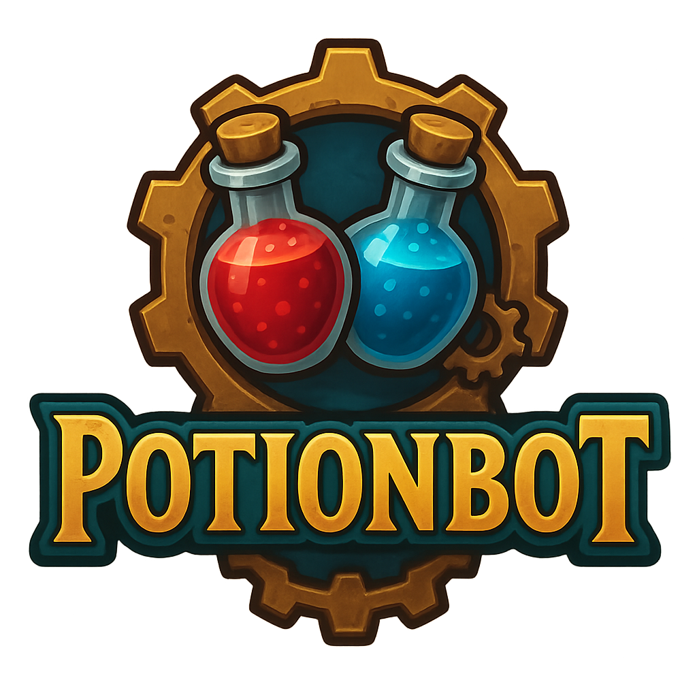

# PotionBot

  

PotionBot is a World of Warcraft addon that automatically creates and updates two macros with the best food, water, health potions, and mana potions in your bags, prioritizing special items like Healthstones and Mana Gems.

## Features

- **Smart Consumable Detection**: Automatically scans your bags for food, water, health and mana potions, Healthstones, and Mana Gems
- **Priority System**:
  - Healthstones are prioritized over health potions
  - Mana Gems are prioritized over mana potions
  - Higher restoration values are preferred; conjured items break ties
- **Well Fed Support**: Prefers buff food when Well Fed is missing and ordinary food when the buff is already active
- **Food Stat Priorities**: Arrange Stamina, Strength, Agility, Intellect, Spirit, Spell power, Attack power, and Healing with Up/Down buttons
- **Automatic Macro Creation**: Creates "HealthPotionBot" and "ManaPotionBot" macros
- **WoW Forever Support**: Targets Forever beta with English tooltip parsing; older client targets are retained but not verified in-game
- **Configurable**: Enable/disable individual macros, toggle Well Fed preference, and save your food stat priority order

## Slash Commands

- `/pb`, `/pp`, or `/potionbot` - Opens the configuration panel
- `/pb status` - Shows selected items and food stat priorities
- `/pb scan` - Rescans your bags
- `/pb enable` - Enables both macros
- `/pb diagnose` - Shows why consumables were selected or skipped

## How It Works

1. The addon scans your bags for consumable items
2. Identifies food, water, potions, Healthstones, and Mana Gems through tooltip analysis
3. Applies your food stat priorities when Well Fed is missing, then compares restoration effectiveness
4. Creates/updates macros with the best available items outside combat
5. Updates when your bag contents or Well Fed buff change; changes during combat wait until combat ends

## Macro Usage

- **HealthPotionBot**: Food outside combat; Healthstone or health potion in combat
- **ManaPotionBot**: Water outside combat; Mana Gem or mana potion in combat
- Use either macro by clicking its action-bar button or pressing its keybind
- The macro tooltip shows the item for your current combat state

## Installation

1. Download and extract to your `Interface/AddOns/PotionBot/` folder
2. Restart WoW or use `/reload`
3. Configure through Interface Options or use `/pb`
4. Drag "HealthPotionBot" and "ManaPotionBot" from `/macro` to your action bars

## Credits

Created and maintained by twids.
